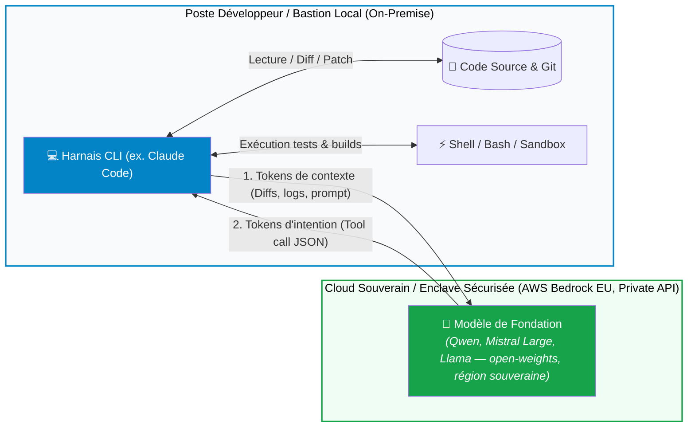
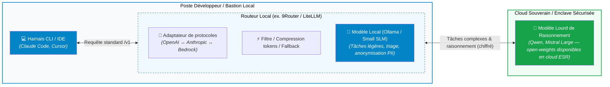

---
# try also 'default' to start simple
theme: seriph
# random image from a curated Unsplash collection by Anthony
# like them? see https://unsplash.com/collections/94734566/slidev
background: https://cover.sli.dev
# some information about your slides (markdown enabled)
title: MODULE 5 — Technologie, Infrastructure & Outils
info: |
  ## Cours Agentic AI
# apply UnoCSS classes to the current slide
class: text-center
# https://sli.dev/features/drawing
pdf: true
export: true
drawings:
  persist: false
# slide transition: https://sli.dev/guide/animations.html#slide-transitions
transition: slide-left
# enable Comark Syntax: https://comark.dev/syntax/markdown
comark: true
download: true
# duration of the presentation
duration: 35min
---
# Module 5 : Technologie, Infrastructure & Outils
## Déployer, orchestrer et évaluer des agents dans le monde réel

  Stack technique, Sécurité & MLOps
  
Focus d'architecture : Modèle hébergé souverain / Harnais d'exécution local

---
layout: center
---

# Une architecture classique : le principe en une phrase

Votre interface reste chez vous, 
l'intelligence part dans un cloud souverain.

  
💻 <b>Le logiciel client</b> AnythingLLM, Claude Code… installés sur votre machine, avec vos habitudes

  
🔌 <b>L'API</b> un simple « lien », une convention de fait (format compatible OpenAI, normalisée par les passerelles type LiteLLM)

  
🧠 <b>Le modèle</b> hébergé sur l'infrastructure fédérée ILaaS

Comme la TV branchée sur un service de streaming : le contenu est produit ailleurs, on le consomme chez soi avec sa télécommande — sans verrouillage.

<!-- Notes : Analogie messagerie aussi possible (Thunderbird + serveur de mail). Le point clé : on découple l'outil du cerveau. C'est ce qui rend la mutation du métier absorbable. Nuance : ce qui transite (diffs, snippets) reste de l'IP sensible — à cadrer par contrat/DPA. -->

---
layout: two-cols-header
---

# L'architecture

::left::

<diagramme>

  <b>VOTRE MACHINE</b> 
  · Claude Code (harnais + boucle agentique) 
  · Skills académiques (markdown) 
  · Fichiers, code, données <i>restent ici</i>

⬇ 🔑 API (Bearer)

  <b>ex. ILaaS — cloud souverain de l'ESR</b> 
  · Passerelle LiteLLM 
  · Modèles : Qwen, Mistral, Gemma… 
  · <i>devllm.ilaas.fr</i>

</diagramme>

::right::

### Ce qui reste chez nous
- Documents, base vectorielle, embeddings
- Code, dépôt, hooks de sécurité
- Les traces / logs d'exécution *(le calcul du raisonnement, lui, s'exécute côté modèle distant)*

### Ce qui part dans le cloud
- Uniquement le **contexte nécessaire**
- Extraits de documents, snippets de code
- Le calcul du modèle, puis le retour

 

✓ Confidentialité maîtrisée — on n'expose jamais tout, seulement le strict nécessaire.

<!-- Notes : L'important à faire passer : seuls des fragments utiles quittent la machine. On ne « donne pas ses données » à l'IA. Mais même ces fragments (diffs, extraits) sont de l'IP sensible : cadrer par contrat, pas par supposition. -->

---

## Evolution des modèles ouverts : pourquoi c'est possible

---
layout: default
---

# Étude de cas d'architecture : L'approche Claude Code

Comment concilier la puissance d'un agent de code avec les impératifs de conformité et de secret industriel ?

svg]:max-w-4xl">

  

    <b>1. L'Agent s'exécute en local :</b> Les actions (git commit, build, tests) tournent directement dans l'environnement du dev, sous son contrôle d'approbation.
  

  

    <b>2. Pas de stockage tiers :</b> Le code n'est jamais indexé de façon permanente dans une base vectorielle externe ; seuls les snippets actifs transitent.
  

  

    <b>3. Enclave d'inférence contractuelle :</b> Le modèle tourne dans une région souveraine ; la non-rétention des logs et le non-usage des prompts sont <b>garantis par contrat (DPA / clause fournisseur)</b>, à vérifier modèle par modèle.
  

---
layout: default
---

# Architecture Réelle : L'intermédiaire du Routeur Local

En pratique, l'agent ne contacte pas directement le Cloud : il passe par une **passerelle locale** (ex. *9Router*, *LiteLLM*).

svg]:max-w-4xl">

<!-- Notes : DeepSeek-R1 ne figure pas au catalogue ILaaS actuel ; il s'utilise en auto-hébergement. La « souveraineté » porte sur l'infrastructure (localisation/hébergeur ESR), pas sur l'origine du modèle (Qwen = Alibaba, non européen). -->

---
layout: default
---

# Architecture Réelle : L'intermédiaire du Routeur Local

En pratique, l'agent ne contacte pas directement le Cloud : il passe par une **passerelle locale** (ex. *9Router*, *LiteLLM*).

  
1. Normalisation de protocole

  

    L'agent parle en standard (OpenAI <code>/v1/chat</code>). Le routeur traduit à la volée vers l'API cible (Anthropic natif, AWS Bedrock EU, Azure OpenAI ou Vertex) sans toucher au harnais.
  

  
2. Tâches traitées 100% en local

  

    Avant d'appeler le Cloud, le routeur peut déléguer à un petit modèle local (SLM via Ollama) : classification de commande, masquage de données sensibles (PII) ou compression de logs de build.
  

  
3. Résilience & Fallback automatique

  

    En cas de saturation de quota, de <i>rate-limit 429</i> ou de panne réseau sur le cloud souverain principal, 9Router bascule instantanément vers un modèle de secours sans interrompre le développeur.
  

  💡 <b>Gain d'architecture :</b> Le développeur manipule un point de terminaison unique (`http://localhost:port`). Toute la complexité d'authentification, de quotas et de conformité est encapsulée dans le routeur.

<!-- Notes : ⚠️ Le fallback multi-modèles casse la reproductibilité : documenter un « modèle de référence » (model of record) par tâche, et évaluer les évals sur le modèle effectivement utilisé. Le masquage PII n'est pas une fonctionnalité cœur de 9Router/LiteLLM — précisez si vous exigez une étape d'anonymisation séparée. -->

---
layout: default
---

# 2. Panorama des Frameworks Agentiques

Le paysage a mûri : on passe des bibliothèques "magiques" aux moteurs de graphes d'états stricts.

  
LangGraph

  
Standard d'ingénierie pour workflows complexes

  <ul class="space-y-1">
    <li>Représente les flux sous forme de <b>graphe d'états</b> : acyclique (workflow linéaire) ou <b>cyclique</b> (boucles agentiques retry / re-planification)</li>
    <li>Persistance native de l'état (State Machine)</li>
    <li>Idéal pour le <i>Human-in-the-loop</i> et le time-travel debugging</li>
  </ul>
  
🎯 Choix recommandé en production industrielle

  
CrewAI / Microsoft Agent Framework

  
Orientés collaboration multi-agents

  <ul class="space-y-1">
    <li>Basés sur la personnification (Rôles, Objectifs, Backstory)</li>
    <li>Prise en main très rapide pour le prototypage</li>
    <li>Moins déterministes ; attention aux boucles d'échanges infinies</li>
    <li>⚠️ <b>AutoGen : maintenance mode depuis oct. 2025</b> → sur les nouveaux projets, préférer <b>AG2</b> (fork actif) ou le <b>Microsoft Agent Framework</b></li>
  </ul>
  
🎯 Idéal pour : POCs, simulations, remue-méninges

  
Harnais Dédiés (Claude Code, OpenHands)

  
Agents verticaux spécialisés code/système

  <ul class="space-y-1">
    <li>Intégration CLI native, gestion fine des tokens et des patchs git</li>
    <li>Boucle d'auto-réflexion branchée directement sur les linters</li>
    <li>Pas besoin d'écrire le graphe : l'agent est clé en main</li>
  </ul>
  
🎯 Idéal pour : Développement logiciel assisté

  💡 <b>Conseil d'architecture :</b> Évitez les sur-couches abstraites pour les tâches critiques. Un script Python typé appelant le SDK officiel natif + Pydantic suffit souvent.

---
layout: default
---

# 3. Le standard MCP (Model Context Protocol)

Comment standardiser l'exposition des outils internes à n'importe quel agent ?

- **La fin des silos :** Un standard ouvert (Open Source) initié fin 2024 pour unifier la connexion modèle ↔ outils.
- **Principe Client / Serveur :**
  - **Serveur MCP :** Expose des ressources, des prompts et des outils via **stdio** (en local) ou **Streamable HTTP** (à distance — un seul endpoint REST, auth OAuth possible). ⚠️ Le transport historique « SSE / HTTP » est **déprécié** depuis la spec **2025-03-26**.
  - **Client MCP :** Votre application, votre IDE (Cursor) ou un agent CLI (Claude Code).
- **Écosystème unifié :** Un serveur MCP écrit pour PostgreSQL ou GitLab fonctionne instantanément avec n'importe quel client compatible.
- ⚠️ **Serveurs de référence obsolètes :** `@modelcontextprotocol/server-postgres` et `mcp/github` sont **archivés/dépréciés depuis 2025** (le serveur Postgres présente un bypass de la restriction `read_only` par injection SQL). Utilisez des serveurs maintenus ou un wrapper basé sur le **SDK officiel**.

  
// Configuration Claude Code / Cursor (mcp.json) :

  { 
  &nbsp;&nbsp;"mcpServers": { 
  &nbsp;&nbsp;&nbsp;&nbsp;"github-officiel": { 
  &nbsp;&nbsp;&nbsp;&nbsp;&nbsp;&nbsp;"type": "http", 
  &nbsp;&nbsp;&nbsp;&nbsp;&nbsp;&nbsp;"url": "https://api.githubcopilot.com/mcp/", 
  &nbsp;&nbsp;&nbsp;&nbsp;&nbsp;&nbsp;"headers": { "Authorization": "Bearer &lt;GITHUB_TOKEN&gt;" } 
  &nbsp;&nbsp;&nbsp;&nbsp;} 
  &nbsp;&nbsp;} 
  }

<!-- Notes : Pour PostgreSQL privilégiez un serveur maintenu (ex. « Postgres MCP Pro ») ou un petit wrapper SDK officiel, avec utilisateur en lecture seule stricte. Insistez : un méta-outil qui exécute du SQL doit TOUJOURS être en lecture seule a minima (règle de moindre privilège). -->

---
layout: default
---

# 4. Mémoire & Connaissances : RAG vs Contexte géant

L'avènement des contextes géants — **1M+ tokens chez les fournisseurs frontières** (Claude Sonnet 4, Gemini 2.x), **128k à 262k sur les modèles hébergés ILaaS** — et du **Prompt Caching** transforme la gestion mémoire :

  
L'approche RAG Classique (Vector Search)

  <ul class="space-y-2">
    <li><b>Principe :</b> Découpage en chunks de <b>~200 à 500 tokens</b> (≈ 150 à 350 mots) avec <b>overlap de 10–20 %</b> + recherche par similarité cosinus.</li>
    <li><b>Quand l'utiliser ?</b>
      - Corpus de taille massive (> 100 millions de tokens, ex. tous les emails de l'entreprise).
      - Besoin de cloisonner strictement les droits d'accès par utilisateur.
    </li>
    <li><b>Point faible :</b> Incapable de répondre à une question transversale (*« Quels sont tous les projets ayant dépassé leur budget en 2025 ? »*).</li>
  </ul>

  
Contexte géant + Prompt Caching (La nouvelle norme)

  <ul class="space-y-2">
    <li><b>Principe :</b> Chez les fournisseurs frontières, on injecte l'intégralité d'un repository git dans le contexte. Sur ILaaS (128k–262k), on adapte : RAG d'abord, injection partielle ensuite.</li>
    <li><b>Prompt Caching :</b> Les tokens du préfixe documenté sont mis en cache côté serveur :
      - <b>Coût du préfixe mis en cache divisé par 10</b> (≈ 90 % d'économie)
      - TTFT réduit jusqu'à ~80 % sur les longs prompts — <i>uniquement si le préfixe est strictement identique</i> (aucune insertion au milieu) et selon la politique du fournisseur.
    </li>
    <li>⚠️ <b>Garder la mesure :</b> au-delà de ~150–200k tokens, coût unitaire élevé et effets <i>lost-in-the-middle</i> (le modèle « oublie » le milieu du contexte).</li>
  </ul>

  💡 <b>Design Pattern moderne :</b> RAG pour filtrer les 5 gros documents pertinents ➔ Injection in extenso dans le contexte avec Caching (lorsque la fenêtre le permet).

<!-- Notes : Les chiffres 90 % et ~80 % correspondent aux gains revendiqués par les fournisseurs frontières sur des préfixes longs et stables — à re-mesurer sur votre fournisseur (LiteLLM/ILaaS), pas à transposer tels quels. -->

---
layout: default
---

# 5. Orchestration en Production & Observabilité

Les agents en production introduisent des modes d'échec non déterministes qu'il faut tracer méthodiquement

### Ce qui doit être supervisé (Traces & Logs) :
- **Arbre de décision (Spans) :** Tracer chaque étape : `Prompt ➔ Réflexion ➔ Outil appelé ➔ Erreur ➔ Re-jeu`.
- **Dérive de budget :** Alertes en temps réel sur la consommation de tokens par utilisateur/tâche.
- **Taux de conversion :** Pourcentage d'objectifs atteints sans intervention humaine.

### La stack d'observabilité agentique :
- **Standards ouverts :** OpenTelemetry (OTel)
- **Outils spécialisés :** Langfuse, Arize Phoenix, LangSmith

  
// Exemple de trace Langfuse / OpenTelemetry :

   
  TRACE [Session-8924] - 42.1s - $0.18 
  ├── 🟢 LLM Call: Planner (Qwen / Mistral — cible souveraine) [820ms] 
  ├── 🟢 Tool Call: search_db(query="user_42") [120ms] 
  ├── 🔴 Tool Call: run_migration() [TIMEOUT 10s] 
  │   └── ⚠️ Error captured: Connection timed out 
  ├── 🟢 LLM Call: Evaluator (Analyse de l'erreur) [1.1s] 
  └── 🟢 Tool Call: retry_with_backoff() [450ms] ✅

---
layout: default
---

# 6. Évaluation des agents : Au-delà du BLEU/ROUGE

Comment savoir si votre agent s'améliore après un changement de prompt ou d'outil ?

  
SWE-bench

  
Le standard d'or du génie logiciel

  
L'agent reçoit une <i>Issue GitHub réelle</i> et le repo complet. Il doit écrire le patch.

  
Métrique : taux de résolution (pass@1) sur deux ensembles — <b>FAIL_TO_PASS</b> (les tests qui échouaient passent grâce au patch) + <b>PASS_TO_PASS</b> (pas de régression). État de l'art ≈ 70 % sur Verified (2025‑2026), ≈ 40 % sur SWE-bench Pro.

  
GAIA & BrowseComp

  
Recherche experte & scénarios « assistant »

  
BrowseComp (OpenAI, 2025) : formuler une question d'expert, chercher sur le web et croiser les sources. GAIA : scénarios « assistant » classiques (fichiers, web, tableurs, e-mails).

  
Métrique : Exact Match (EM) sur la réponse factuelle finale (notation manuelle d'experts pour BrowseComp).

  
Evals Métier Unitaires

  
Votre propre harnais de test CI/CD

  
Créer 30 scénarios représentatifs de votre SI avec assertions sur l'état final du système (BD, fichiers créés).

  
Métrique : Taux de succès à la non-régression avant déploiement.

  🎯 <b>Principe fondamental :</b> On n'évalue pas un agent sur ce qu'il <i>dit</i>, mais sur l'<i>état final du système</i> après ses actions.

<!-- Notes : L'EM de GAIA/BrowseComp pénalise les réponses correctes mais reformulées → compléter systématiquement par un juge LLM (LLM-as-a-judge) sur vos évals métier. -->

---
layout: default
---

# Synthèse : Checklist d'industrialisation

Pour passer un système agentique en production sereinement :

  <ul class="text-xs space-y-2 text-gray-700 dark:text-gray-200">
    <li>🔒 <b>Architecture réseau :</b> Privilégier le harnais local proche des données sensibles avec appels vers des endpoints LLM sous contrat entreprise (<b>non-rétention négociée par DPA</b>, à vérifier modèle par modèle).</li>
    <li>🔌 <b>Interconnexion standardisée :</b> Adopter <b>MCP</b> (transports stdio / Streamable HTTP) pour vos connecteurs internes afin d'éviter la dépendance à un framework applicatif.</li>
    <li>🛡️ <b>Sécurité d'exécution :</b> Isoler tout outil de code dans une sandbox étanche (MicroVM / conteneurs éphémères non root, <i>pas Docker "nu"</i>) avec confirmation humaine sur les actions critiques.</li>
    <li>📊 <b>Observabilité complète :</b> Instrumenter les spans d'exécution via OpenTelemetry / Langfuse dès le premier jour pour diagnostiquer les boucles.</li>
    <li>🧪 <b>Culture d'évaluation continue :</b> Évaluer systématiquement toute montée de version de modèle ou de prompt sur un jeu d'épreuve automatisé (Evals) — en documentant le <b>modèle de référence</b> utilisé pour rester reproductible.</li>
  </ul>

---
layout: end
class: text-center
---

# Une première démo
### Créer une page web à l'aide de claude code connecté à iLaaS

---
layout: end
class: text-center
---

# Fin du Module 5
### Questions, outillage & discussions d'infrastructure !
